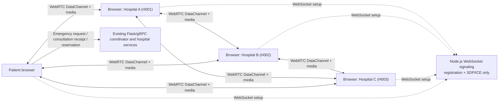

# Distributed Hospital Emergency & Bed Allocation System

This repository gives a simple college mini project that demonstrates a distributed system using gRPC, RabbitMQ, and MongoDB between hospital nodes.

## Project description
The system is built around a coordinator and three hospital nodes. The coordinator checks each hospital over gRPC, identifies the best available hospital, and reserves a bed only after staff complete a request-specific consultation.

## Core idea
The actual bed decisions happen in the hospital processes. The coordinator never manipulates the hospital's local data directly.

## Technologies used
- Python
- Flask
- gRPC
- RabbitMQ
- MongoDB
- Docker
- Apache Hadoop Streaming and HDFS (optional analytics profile)
- Knative Serving on Kubernetes (optional scale-to-zero analytics)
- React
- Vite
- Node.js WebSocket signaling
- WebRTC (RTCPeerConnection, RTCDataChannel, audio/video)
- CSS

## Why this is a good distributed systems demo
- Each hospital runs independently
- The coordinator acts as the central manager
- Hospitals expose local operations over gRPC
- Docker is used only to virtualize and run the services in a containerized way
- The system is easy to explain in a viva or project demo

## Lamport logical clocks
Each process starts its Lamport clock at zero, advances it before local events and sends, and merges received timestamps using `max(local, received) + 1`. Coordinator RPCs carry a Lamport timestamp to the selected hospital. Reservation and release events persist their timestamp and return it to the coordinator, which merges the reply before its next event. The fair reservation mutex orders requests by Lamport timestamp; Communication Logs display `L<timestamp>` and the originating node. These clocks preserve happened-before ordering but cannot distinguish every concurrent event. MongoDB atomically advances each node's clock so it survives process restarts.

## Vector clocks
Hospital status, availability, reservation, and release RPCs also exchange per-node vector timestamps. The hospital merges the coordinator's vector and advances its own component; the coordinator merges the reply. Reservation records and Communication Logs retain the vector, and logs display it as `V{node:counter,...}`. VectorClock.compare distinguishes before/after/equal from concurrent events, which a single Lamport number cannot identify. Vector counters are persisted per node in MongoDB and survive process restarts.

## Clock synchronization estimates and Berkeley synchronization
Each hospital status RPC includes receive/send wall-clock samples. The coordinator uses the four NTP timestamps to estimate the hospital's clock offset and round-trip delay, shown on the hospital card. The estimate assumes network-path symmetry and is refreshed with status polling.

Select **Run Berkeley Synchronization** on the dashboard to average the coordinator's clock with online hospitals that have a current offset estimate, then send each participant its correction. The dashboard reports the average, each applied correction, and any skipped or unreachable hospitals. Corrections adjust simulated clock readings in the coordinator and hospital processes; they never change host operating-system clocks, are not persisted across restarts, and do not guarantee synchronization in the presence of clock drift or asymmetric network delay.

## Global state snapshots
From the dashboard, the coordinator can capture and persist a view of all configured hospitals' online status, available beds, and local Lamport timestamps. Each status reply is causally ordered with the coordinator using the existing Lamport clock exchange. The hospitals are queried sequentially, so the saved result is an explicitly best-effort view, not an atomic Chandy–Lamport consistent cut; in-flight channel messages are not recorded.

## Hospital heartbeat beacons
Each hospital sends an HTTP liveness beacon to the coordinator every two seconds. The coordinator also sends gRPC heartbeats to hospitals on the same interval. A hospital that misses the coordinator for eight seconds automatically starts a Ring election; the selected hospital then sends heartbeats to the other nodes. The dashboard shows both heartbeat directions and the current elected leader. **Run Ring Election** demonstrates the same candidate-ID circulation manually; **Run Bully Election** remains available for comparison. A timeout is suspicion, not proof of a crash, and network partitions may produce competing elections.

The backend hospital heartbeat/election flow remains independent of the browser simulation. The live browser Bully election chooses the highest reachable hospital ID; neither election migrates the Flask API or MongoDB state, so this is not transparent service failover.

## Guided hospital coordination story

After logging in, open **Hospital coordination story** from the sidebar or scroll to the bottom of the workspace. Click **Play story** to watch a plain-language, animated explanation of event ordering, parallel work, heartbeat checks, leader election, and taking turns on a shared reservation. The story also offers **Pause story**, **Previous**, **Next part**, and direct step navigation. It is a deterministic teaching scenario and does not modify live hospital state.

## Browser hospital network: WebRTC, elections, and resources

The frontend starts with **Patient Login** and **Hospital Login**. Patients enter their name only; hospital staff enter a name and select H001/H002/H003. Each hospital must use a separate browser session (one session per hospital ID); duplicate registrations replace the older session. Patients can view hospital availability and request a bed. Hospitals see their patient history and can discharge a confirmed patient, which releases the bed and retains the record with a discharged status. The browser role split is a demo UI, not authenticated backend access control.

The WebSocket service only exchanges registration/presence and WebRTC SDP/ICE setup. Hospital application protocols, Lamport timestamps, election traffic, heartbeat messages, ICU requests/results, and call-control messages use WebRTC RTCDataChannels. Audio/video media uses the negotiated peer-to-peer RTCPeerConnection. There is no user-to-user chat feature. The live architecture map and activity log consume real browser peer/signaling callbacks; Archify was not installed in this workspace, so no Archify API/runtime integration is claimed.

### Architecture



The diagram reflects the application's intended topology. Green live edges in the dashboard are drawn from current RTCPeerConnection/DataChannel states, not assumed from the signaling roster. No Archify-generated view is included because the requested skill was unavailable.

### Install and run

1. Start the existing backend/hospital/MongoDB/RabbitMQ services as described in [backend/README.md](./backend/README.md) if you want to demonstrate the existing emergency request and bed-reservation workflow.
2. In one terminal, install frontend dependencies and start the separate signaling process:

   ```powershell
   cd frontend
   npm install
   npm run signaling
   ```

   The signaling health endpoint is `http://localhost:8001/health`.
3. In another terminal, start the React/Vite application:

   ```powershell
   cd frontend
   npm run dev
   ```

   Open `http://localhost:5173`. For a two-laptop demo, use a trusted HTTPS certificate whose subject alternative names include the host's LAN name/IP. Set `HTTPS_KEY_PATH` and `HTTPS_CERT_PATH` for Vite and `SIGNALING_TLS_KEY` and `SIGNALING_TLS_CERT` for the signaling process to the same key/certificate, then run Vite with `npm run dev -- --host 0.0.0.0`; allow inbound TCP 5173 and 8001 through the host firewall. Open the HTTPS URL from the second laptop and trust the certificate there. Browsers generally deny camera/microphone access on a plain HTTP LAN address. Use `localhost` for same-computer tests.
4. For networks that cannot form direct ICE paths, configure a TURN server that supports coturn's shared-secret REST authentication. The browser fetches short-lived credentials from the signaling service; the shared secret stays server-side. For Docker Compose, add your TURN service's public relay URLs and its TURN REST shared secret to the ignored root `.env` file:

   ```dotenv
   TURN_URLS=turn:turn.example.net:3478?transport=udp,turns:turn.example.net:5349?transport=tcp
   TURN_SHARED_SECRET=your-turn-rest-shared-secret
   TURN_CREDENTIAL_TTL_SECONDS=3600
   ```

   Replace the example host and secret with values from a TURN server reachable from both clients. Do not put a provider API key or a permanent browser username/password here. The secret must be the TURN server's shared secret for REST-style temporary credentials. Allow the provider's required TURN UDP/TCP ports. Then recreate the signaling service so it loads the settings:

   ```powershell
   docker compose --profile public --profile quick-tunnel up -d --build signaling
   ```

   Both Docker and local Vite use the signaling service's `/ice-config` endpoint. Without `TURN_URLS` and `TURN_SHARED_SECRET`, the app uses public STUN only; STUN discovers possible paths but does not relay media or data channels. Cloudflare Tunnel relays the website and signaling WebSocket, not the WebRTC call. A TURN server is required when the clients cannot connect directly. A TURN relay must be hosted on a publicly reachable server; running one on the same laptop behind the same NAT does not solve cross-network connectivity unless that network is explicitly configured to forward the TURN ports.

### One public URL for multiple PCs

For access from different networks, publish the frontend through Cloudflare Tunnel. The frontend container proxies API and WebSocket traffic, so people can use one HTTPS URL from other networks. A laptop-hosted Quick Tunnel needs no account or domain, but its generated URL is temporary and the app is available only while the laptop, Docker, and internet connection remain on. For an always-available stable hostname, use a named tunnel on an always-on VPS and a domain you control.

#### Temporary laptop demo with Cloudflare Quick Tunnel

This is the fastest way to let someone on another network open your currently running app. It requires Docker Desktop but no Cloudflare account, domain, or token. Copy `.env.example` to `.env` if needed, and set `BIND_ADDRESS=127.0.0.1` there so service ports are not exposed to the local network. The Quick Tunnel connector uses HTTP/2 over TCP to avoid unreliable UDP/QUIC paths on some laptop networks. Start it from the repository folder:

```powershell
docker compose --profile public --profile quick-tunnel up -d --build
docker compose --profile public --profile quick-tunnel logs -f cloudflare-quick-tunnel
```

Copy the `https://....trycloudflare.com` URL printed in the tunnel logs and share it. The URL is generated by Cloudflare and may change when the tunnel is recreated; there is no permanent link to provide before it is running. Keep the terminal/log session open to watch connection status. Brief signaling disconnects retain browser peer presence for 15 seconds while clients reconnect; a stopped app or a longer interruption still takes the node offline. To stop publishing the app, press Ctrl+C in the logs window and run `docker compose --profile public --profile quick-tunnel down`. Do not use this demo with real patient data: the app has no user authentication.

#### Cloudflare Tunnel with a named tunnel

This is the recommended VPS setup when you do not want to open inbound web ports on the VM. It requires a Cloudflare account, a domain managed by Cloudflare, and an always-on Linux VPS with Docker Engine and the Docker Compose plugin. In Cloudflare Zero Trust, create a named tunnel, add a public hostname such as `hospital.your-domain.com`, and route it to the HTTP origin `frontend:80`. Keep the tunnel token private. The resulting app URL will be `https://hospital.your-domain.com`; use your own domain in place of the example.

On an Ubuntu/Debian VPS, make sure Docker starts when the machine boots, clone the repository, and create the ignored `.env` file:

```bash
sudo systemctl enable --now docker
git clone https://github.com/shravni2005/Distributed-System-FA.git /opt/distributed-hospital-system
cd /opt/distributed-hospital-system
cp .env.example .env
nano .env
```

Set `CLOUDFLARE_TUNNEL_TOKEN` in `.env` to the token from Cloudflare and keep `BIND_ADDRESS=127.0.0.1`. Never commit `.env` or send the tunnel token in chat. Start the stack in detached mode so the command returns to the shell:

```bash
docker compose --profile public --profile cloudflare up -d --build
docker compose --profile public --profile cloudflare ps
docker compose --profile public --profile cloudflare logs --tail=50 cloudflared
```

Open the configured `https://hospital.your-domain.com` hostname after the logs show the tunnel is connected. Cloudflare provides HTTPS at the edge; the frontend's same-origin `/api/` and `/ws` proxy routes keep the API and WebRTC signaling off the public interface. No Caddy profile or inbound 80/443 firewall rule is needed. Compose uses `restart: unless-stopped`, so containers restart after a process failure or VM/Docker restart; do not run `docker compose down` if you want the site to stay online. Check it later with `docker compose --profile public --profile cloudflare ps` and `docker compose --profile public --profile cloudflare logs --tail=50 cloudflared`. To deploy code updates, pull the changes and rerun the `up -d --build` command. A tunnel does not keep a sleeping or powered-off computer online. WebRTC media still uses peer-to-peer ICE and may require a separately configured TURN server on restrictive networks.

#### Caddy on a VPS with a public IP

This alternative publishes the app directly from a Linux VM and automatically obtains HTTPS certificates with Caddy. Before deploying, arrange:

- A Linux VM with Docker Engine and the Docker Compose plugin installed.
- A public static IP and a domain name that you control. Point the domain's DNS `A` record to the VM's IP (and only add an `AAAA` record if IPv6 is configured).
- Inbound TCP ports 80 and 443 allowed by both the VM firewall and cloud firewall/security group.

On the VM, clone this repository, copy `.env.example` to `.env`, and replace `PUBLIC_DOMAIN` with your real domain. Keep `BIND_ADDRESS=127.0.0.1` so database, broker, API, and hospital ports are not exposed on the public network. Then run:

```bash
docker compose --profile public --profile caddy up -d --build
docker compose ps
```

Wait for DNS to resolve and for Caddy to issue its certificate, then open `https://your-domain`. To update after pulling changes, run `docker compose --profile public --profile caddy up -d --build` again. The Compose restart policy brings services back after a Docker/VM restart, and named volumes retain MongoDB data and Caddy certificates.

Only ports 80 and 443 are intended to be reachable publicly for this Caddy option; MongoDB, RabbitMQ, the coordinator, and hospital RPC ports are bound to loopback or remain on the private Compose network. Keep the VM/cloud firewall restricted to inbound TCP 80/443 and SSH. Without a `.env` file, Compose keeps the original local behavior and binds its development ports to all interfaces. The local workflow remains available with `docker compose up --build` and the Vite development server.

**Demo safety:** this app does not authenticate users or protect patient data. Do not expose real patient information or use this as a production medical service. For real use, add authentication/authorization, privacy controls, backups, replicated databases, monitoring, and security review. WebRTC video also depends on peers being able to establish a direct ICE connection; some networks require a separately configured TURN service.

### Two-laptop demonstration

1. Start signaling and Vite on the host machine, then open the HTTPS app on both laptops. Grant camera/microphone permission when prompted.
2. On one device, choose **Hospital Login**, enter a staff name, select a hospital, and click **Go online**.
3. On the other device, choose **Patient Login** and enter only a patient name. Click **Go online**, review hospital availability, and submit a bed request. Accept the incoming WebRTC consultation at the hospital; once the consultation is complete, confirm the reservation on the patient screen.
4. The hospital screen's **Patient history** lists its confirmed placements. Use **Discharge patient** to release a bed while retaining the discharged record.
5. Open separate hospital sessions with different hospital IDs to demonstrate peer connections and the **Refresh care desk lead** election control.

The browser identities are demonstration identities rather than authentication; the role-specific screens do not secure the API against direct requests. The ICU visualization is per simulated browser node and is not replicated into the Python hospital state. The backend's real emergency reservation continues to recheck and atomically reserve against the selected hospital. Consultation receipts prove that the browser reported completion; this prototype does not cryptographically attest WebRTC call state. Do not use it with real patient data.

## Persistence
MongoDB stores hospital bed state, reservation and release history, communication events, coordinator logs, and emergency request records. The Docker Compose `mongodb_data` volume keeps this data across hospital and container restarts.

## HDFS and Hadoop batch analytics

The optional `analytics` Compose profile starts an HDFS NameNode, two DataNodes, a YARN ResourceManager, and two NodeManagers. The Activity report's **Archive to HDFS** action writes a de-identified NDJSON snapshot through WebHDFS; its path is returned to the browser. Named Docker volumes persist the NameNode and each DataNode's storage. DataNodes advertise their Compose hostnames, and loopback-only host ports let a coordinator running directly on Windows follow WebHDFS redirects. Compose uses the local cluster's insecure Hadoop simple-auth `root` identity to write archives; do not expose this learning cluster to untrusted networks.

Start the regular project and the distributed analytics cluster with:

```bash
docker compose --profile analytics up --build -d
```

If another local MongoDB already occupies port 27017, choose an unused host port without changing the container network:

```powershell
$env:MONGODB_HOST_PORT = "27019"
docker compose --profile analytics up --build -d
```

`MONGODB_HOST_PORT` only changes the optional host mapping; coordinator and hospital services continue to use the internal MongoDB service. The separate MongoDB port 27018 remains available for Compass.

Wait until the NameNode UI at `http://localhost:9870` reports two live DataNodes and the YARN ResourceManager UI at `http://localhost:8088` is available. Archive a report from the Activity report panel, or use `POST http://localhost:5000/api/analytics/hdfs/export`. The response contains the HDFS path. Submit the Hadoop Streaming job from the NameNode container, replacing the input and output paths with the response path and a new output directory:

PowerShell on Windows:

```powershell
$archive = Invoke-RestMethod -Method Post -Uri http://localhost:5000/api/analytics/hdfs/export
$outputPath = "/hospital-analytics/results/run-001"
docker compose --profile analytics exec namenode hdfs dfs -mkdir -p /hospital-analytics/results
docker compose --profile analytics exec namenode bash /opt/hospital-analytics/run_hadoop_job.sh "$($archive.hdfs_path)" $outputPath
docker compose --profile analytics exec namenode hdfs dfs -cat "$outputPath/part-00000"
```

Bash:

```bash
docker compose --profile analytics exec namenode hdfs dfs -mkdir -p /hospital-analytics/results
docker compose --profile analytics exec namenode bash /opt/hospital-analytics/run_hadoop_job.sh \
  /hospital-analytics/exports/analytics-REPLACE-WITH-ARCHIVE-FILENAME.ndjson \
  /hospital-analytics/results/run-001
docker compose --profile analytics exec namenode hdfs dfs -cat /hospital-analytics/results/run-001/part-00000
```

The job runs on YARN workers and reads/writes HDFS. The Python mapper/reducer are kept for local compatibility; the YARN runner uses equivalent Perl Streaming scripts because the supplied Hadoop worker image has Perl but no Python runtime. It remains a batch report path; live allocation and patient records stay in the existing MongoDB/coordinator flow. The Hadoop containers are a learning cluster, not a highly available HDFS deployment (one NameNode remains a single point of failure).

## Serverless analytics

The existing coordinator and hospital processes still need to run continuously for gRPC, heartbeats, RabbitMQ, and reservations. The analytics summary can additionally run as an on-demand **Knative Serving** function, whose pod scales to zero while idle. Knative is free and open-source but needs a Kubernetes cluster; its serving/networking components must be installed separately.

Build the backend image into your local Kubernetes cluster as in the Kubernetes section, install Knative Serving using its [official installation guide](https://knative.dev/docs/install/), and then deploy the function:

```bash
kubectl apply -f deploy/knative-analytics.yaml
kubectl rollout status -n distributed-hospital ksvc/analytics-function
kubectl set env deployment/coordinator ANALYTICS_FUNCTION_URL=http://analytics-function.distributed-hospital.svc.cluster.local -n distributed-hospital
```

The analytics summary endpoint now invokes the function and reports `Knative serverless function` as its engine. If the function is configured but unavailable, the API returns an error rather than silently computing a local result. Without that setting, the existing local MapReduce-compatible summary remains available. This function accepts only de-identified analytics dimensions; it is not used for patient placement or clinical decisions.

## Kubernetes deployment
The complete browser-to-backend demo is described by [deploy/kubernetes.yaml](./deploy/kubernetes.yaml): MongoDB, RabbitMQ, coordinator, three hospital nodes, signaling, and the frontend. The frontend's Nginx proxy routes same-origin API and WebSocket requests to the cluster Services. The frontend Service is a NodePort on `30080`.

For a local Minikube deployment from PowerShell, build the three images and load them into Minikube:

```powershell
minikube start
docker build -t distributed-hospital-backend:local .\backend
docker build -t distributed-hospital-frontend:local .\frontend
docker build -t distributed-hospital-signaling:local -f .\frontend\signaling\Dockerfile .\frontend
minikube image load distributed-hospital-backend:local
minikube image load distributed-hospital-frontend:local
minikube image load distributed-hospital-signaling:local
kubectl apply -f .\deploy\kubernetes.yaml
kubectl rollout status -n distributed-hospital deployment/mongodb
kubectl rollout status -n distributed-hospital deployment/rabbitmq
kubectl rollout status -n distributed-hospital deployment/coordinator
kubectl rollout status -n distributed-hospital deployment/hospital-1
kubectl rollout status -n distributed-hospital deployment/hospital-2
kubectl rollout status -n distributed-hospital deployment/hospital-3
kubectl rollout status -n distributed-hospital deployment/signaling
kubectl rollout status -n distributed-hospital deployment/frontend
kubectl port-forward -n distributed-hospital service/frontend 8080:80
```

Open `http://localhost:8080`; localhost is treated as a secure browser context for camera/microphone permissions. For remote clients, do not rely on the plain-HTTP NodePort for video calls. Install an Ingress controller, point a real DNS name to it, provision a TLS secret (or cert-manager), replace `hospital.example.com` in `deploy/kubernetes-ingress.yaml`, and apply that optional TLS Ingress. WebRTC can still require a separately provisioned TURN service on restrictive networks.

The manifest uses one MongoDB and RabbitMQ pod with persistent volume claims. This is a learning/demo deployment, not a highly available production database: the data stores are not replicated, and their volumes are not a backup strategy. The manifest has not been applied in this workspace because no Kubernetes context is configured; run the rollout checks above on a local or cloud cluster. Knative is optional and requires Knative Serving and its networking layer before applying `deploy/knative-analytics.yaml`.

## How the paradigms fit this project
- Distributed web-based system: already implemented with the React dashboard and Flask/gRPC coordinator/hospital services.
- Distributed object-based access: the coordinator uses a `RemoteHospitalObject` proxy bound to each hospital ID and invokes an allowlisted remote operation through gRPC; the hospital process remains authoritative for its own state.
- Distributed database: MongoDB persists hospital state and coordination records. Bed counts are conditionally decremented atomically at the selected hospital; the coordinator's availability view can become stale, so the hospital rechecks and remains authoritative.
- Kubernetes: manifests run the hospital application; Knative optionally provides scale-to-zero analytics functions.
- Distributed file systems and Hadoop: an optional two-DataNode HDFS/YARN Compose cluster archives de-identified analytics and runs the Hadoop Streaming mapper/reducer across workers.
- Serverless: the analytics report can invoke a Knative function on demand; the coordinator and hospital nodes remain long-running services.
- Blockchain/distributed ledgers: not needed for a trusted hospital coordinator and would add latency and operational complexity without improving bed allocation.
- Megaport, Cloudflare, and AWS are explained as external architecture examples below; they are not connected to this local deployment.

## Real-world architecture examples

These are illustrative case studies, not integrations or endorsements:

- **Megaport:** [Megaport Cloud Router](https://www.megaport.com/products/megaport-cloud-router/) is a virtual networking service for private connectivity between cloud and data-center environments. It is a useful example of the network layer connecting distributed sites; it is not a file system or application scheduler.
- **Cloudflare:** [Polestar's Cloudflare case study](https://www.cloudflare.com/case-studies/polestar/) describes Cloudflare connectivity supporting its global ecommerce and development operations. Cloudflare Workers are a separate serverless example: they execute request handlers on Cloudflare's edge network. Neither service is configured in this project.
- **AWS:** The [AWS case-study collection](https://aws.amazon.com/solutions/case-studies/) describes customer workloads built on AWS managed and distributed services. For this project, AWS Lambda, S3, and managed Kubernetes are comparable service categories—not configured dependencies.

Company products, pricing, and case studies change over time; consult each provider's current documentation before deployment.

The remote-hospital proxy is a teaching implementation of object-style remote invocation, not a full distributed object runtime: it does not serialize arbitrary objects, preserve remote object lifecycles, or provide transparent references across processes.

## Limitations
This is a prototype. The browser signaling service supports TLS when supplied a certificate, but does not authenticate users; coordinator/API replication and a production distributed lock are not implemented.

## How to start
Please read the backend README for the service commands and use Docker for container-based startup when needed.
